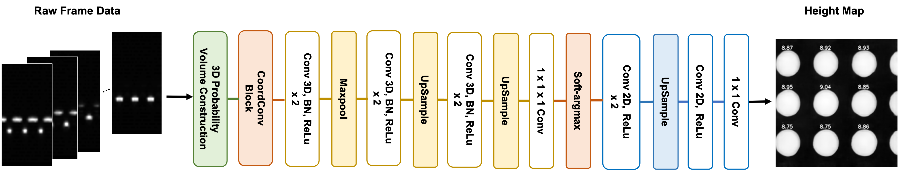

# 3D coordinate-aware deep learning for estimating heights of micro-bumps from projections

Chaeyoung Lee, Seungmi Oh, Yujin Jang, and Jeongtae Kim

This repository implements micro-bump height-map reconstruction from optical-triangulation probability volumes. The network combines coordinate-aware 3D convolution, differentiable soft-argmax, and a 2D CNN refiner.

Training and evaluation are available through `run.sh`. Evaluation computes pixel-level reconstruction metrics, substrate repeatability, and bump-height metrics during testing.



## Installation

Use Python 3.10 or newer with the packages listed in `requirements.txt`. For GPU execution, use a PyTorch installation compatible with your NVIDIA driver.

```bash
python3 -m venv .venv
source .venv/bin/activate
python -m pip install -r requirements.txt
```

## Dataset

The Coin Bump Dataset is available on [Zenodo](https://doi.org/10.5281/zenodo.23488779).

Set `DATASET_PATH` to the extracted dataset root.

| Path under dataset root | Contents |
| --- | --- |
| `train/3d_volume`, `val/3d_volume` | Training and validation NPY volumes |
| `train/interfero`, `val/interfero` | Corresponding CSI height-map CSVs |
| `repeat_test/{1..10}/3d_volume` | Repeated test NPY volumes |
| `repeat_test/{1..10}/interfero` | Corresponding CSI height-map CSVs |
| `repeat_test/{1..10}/height` | Reference bump-height CSVs containing `idx` and `final_h` |

Input volumes have shape `(56, 46, 32)`. The network reconstructs height maps of `232 x 232` pixels, expressed in micrometers.

Repeated test scans must share ROI filenames. For sequence training, filenames follow `<ROI>-<scan>.npy`, with matching CSV names.

## Training and testing

All relative paths are resolved from the project directory. Default data and output directories are `./data` and `./outputs`.

```bash
# Train, test, or train followed by test.
DATASET_PATH=/path/to/dataset bash run.sh train
DATASET_PATH=/path/to/dataset bash run.sh test
DATASET_PATH=/path/to/dataset bash run.sh all

# Override training settings.
DATASET_PATH=/path/to/dataset CUDA_VISIBLE_DEVICES=0 \
EXPERIMENT_NAME=full SEED=42 INITIAL_LR=1e-4 WEIGHT_DECAY=1e-5 \
LAMBDA_C=0.3 LAMBDA_T=0.1 bash run.sh train

# Test an existing model using its exact folder name.
DATASET_PATH=/path/to/dataset MODEL_ROOT=/path/to/models \
MODEL_FEATURE=your_model_folder MODEL_MODE=both EVAL_WORKERS=4 bash run.sh test
```

`MODEL_MODE` accepts `final`, `mini`, or `both`. Both checkpoints are evaluated separately. Missing checkpoints raise an error. Architecture settings are restored from the checkpoint during testing.

`mini` is the checkpoint with the lowest observed validation loss. In the current training loop, `final` is saved at non-improving validation steps and is not guaranteed to represent the last training epoch.

### Experiment presets

| `EXPERIMENT_NAME` | Configuration | Default `LAMBDA_C`, `LAMBDA_T` |
| --- | --- | --- |
| `full` | Complete model | `0.2`, `0.1` |
| `recon` | Reconstruction loss only | `0`, `0` |
| `consis` | Reconstruction and consistency | `0.2`, `0` |
| `wo2d` | Without the 2D CNN refiner | `0.2`, `0.1` |
| `wocoord` | Without coordinate convolution | `0.2`, `0.1` |

Environment variables override these presets.

Other defaults are `SEED=42`, `INITIAL_LR=5e-4`, `WEIGHT_DECAY=1e-5`, `EPOCHS=150`, `BATCH_SIZE=6`, and `BATCH_SIZE_TEST=32`.

These are runnable defaults, not a complete set of configurations reproducing every row in the paper. Reproduction requires the experiment-specific settings in Supplementary Table S2 and the corresponding checkpoint-selection rule.

The training objective is:

`(1 - LAMBDA_C - LAMBDA_T) * L_r + LAMBDA_C * L_c + LAMBDA_T * L_t`

Use nonnegative weights whose sum does not exceed one. Sequence training samples five repeated scans per ROI by default; reconstruction-only training uses individual volumes.

Automatically generated model names include the experiment, seed, learning rate, weight decay, and loss weights. When changing other settings, specify a distinct `MODEL_FEATURE` to avoid reusing an output directory.

### Multiple seeds

A separate queue script is not required.

```bash
for seed in 0 26 42; do
    DATASET_PATH=/path/to/dataset SEED="$seed" MODEL_MODE=both bash run.sh all || break
done
```

## Evaluation

Repeated-scan results are saved under:

`MODEL_ROOT/MODEL_FEATURE/model_{final|mini}/repeat_test/`

| File | Contents |
| --- | --- |
| `test_summary.txt` | All five evaluation metrics |
| `pixel_metrics.txt` | Pixel MAE, pixel repeatability, substrate repeatability |
| `height_summary.txt` | Bump MAE, bump repeatability, evaluation counts and exclusions |
| `pixel_cohort.csv` | ROI inclusion flags for pixel metrics |
| `height_details.csv` | Individual predicted and reference bump heights |
| `height_maps.csv` | Detection, matching, and measurement statuses |
| `{scan}/map/pred/*.csv` | Predicted height maps |
| `{scan}/map/gt/*.csv` | Available evaluation GT maps |

Summary metrics are expressed in `10^-2 um`. Map and height-detail CSVs retain micrometers.

| Metric | Definition |
| --- | --- |
| `E_p` | Pixel-wise mean absolute error against CSI height maps |
| `sigma_p` | Mean pixel-wise standard deviation across repeated scans |
| `sigma_s` | Pixel-wise repeatability within a fixed substrate mask |
| `E_b` | Mean absolute error of extracted bump heights against GT `final_h` |
| `sigma_b` | Mean standard deviation of individual bump heights across repeated scans |

Repeatability uses population standard deviation (`ddof=0`). Different random seeds are evaluated independently and are not pooled as repeated scans.

The substrate mask is defined from scan-1 GT pixels at or below its 10th percentile and remains fixed across repeated scans.

### Bump-height extraction

Bump centers and heights are estimated from predicted maps. GT is used only for matching and evaluation.

Center detection uses binarization, sum projections, and periodic-grid template refinement. A substrate plane is fitted using L1 regression. A `7 x 7` window is searched over offsets of +/-4 pixels around each detected center. The estimated height is the maximum window mean minus the fitted plane value at that window's center.

CPU height evaluation uses a persistent process pool during testing.

Bump metrics use matched bumps with valid measurements in all requested scans. Detection-count mismatches, position mismatches, and measurement failures are reported and excluded. Cohorts can differ between metrics and models; compare matching IDs when comparing methods.

Missing GT permits prediction and height extraction, but corresponding reference-based metrics are unavailable.

**Release alignment:** The current bump extractor uses global P25 base candidates, while the supplied 2026-10-20 manuscript describes P10. Reconcile this setting before the paper-matched release. Substrate repeatability independently uses GT P10.

## Results reported in the manuscript

All metrics are expressed in `10^-2 um`; lower is better. Learned-model results are mean ± standard deviation across three random seeds.

The following values are transcribed from the supplied manuscript, not newly verified outputs of this code revision.

| Method | E_p | sigma_p | sigma_s | E_b | sigma_b |
| --- | ---: | ---: | ---: | ---: | ---: |
| MAP | 164.74 | 7.47 | 10.92 | 13.59 | 4.20 |
| Proposed (L_r) | **28.53 ± 0.32** | 7.67 ± 0.07 | 4.78 ± 0.65 | 12.67 ± 0.35 | 3.58 ± 0.16 |
| Proposed (L_r + L_c) | 32.61 ± 0.82 | 6.15 ± 0.54 | 3.73 ± 0.15 | 13.34 ± 0.53 | 2.56 ± 0.33 |
| Proposed (L_r + L_c + L_t) | 29.38 ± 0.45 | **4.12 ± 0.67** | **1.99 ± 0.75** | **11.19 ± 0.56** | **1.79 ± 0.08** |
| Without CoordConv | 43.36 ± 1.10 | 9.13 ± 0.42 | 3.83 ± 0.11 | 13.04 ± 0.92 | 3.03 ± 0.05 |
| Without 2D CNN | 34.38 ± 0.07 | 5.33 ± 0.24 | 2.79 ± 0.57 | 13.76 ± 0.88 | 3.67 ± 0.19 |

### Inference time

The manuscript reports 3.68 ms/patch on a single NVIDIA RTX PRO 6000 Blackwell Server Edition GPU, using batch size 32 over 30 test-set passes.

This is amortized network forward time, excluding acquisition, volume preparation, file I/O, device transfers, and bump-height extraction. It is not batch-1 latency or the wall time of `run.sh test`.

Approximately nine bumps per patch correspond to 0.409 ms/bump by division.

## Code availability

The code archive cited in the supplied manuscript is available at [Zenodo](https://doi.org/10.5281/zenodo.23498024).

This link does not automatically identify the unreleased working revision. Update the version-specific archive link after creating the new release.

## Credits and license

The coin-bump test wafer was provided by ATI. This repository implements the proposed deep-learning pipeline; MAP results are included for comparison.

Licensed under the [MIT License](LICENSE).